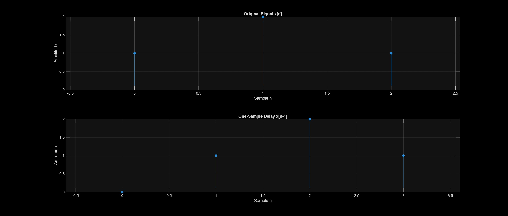
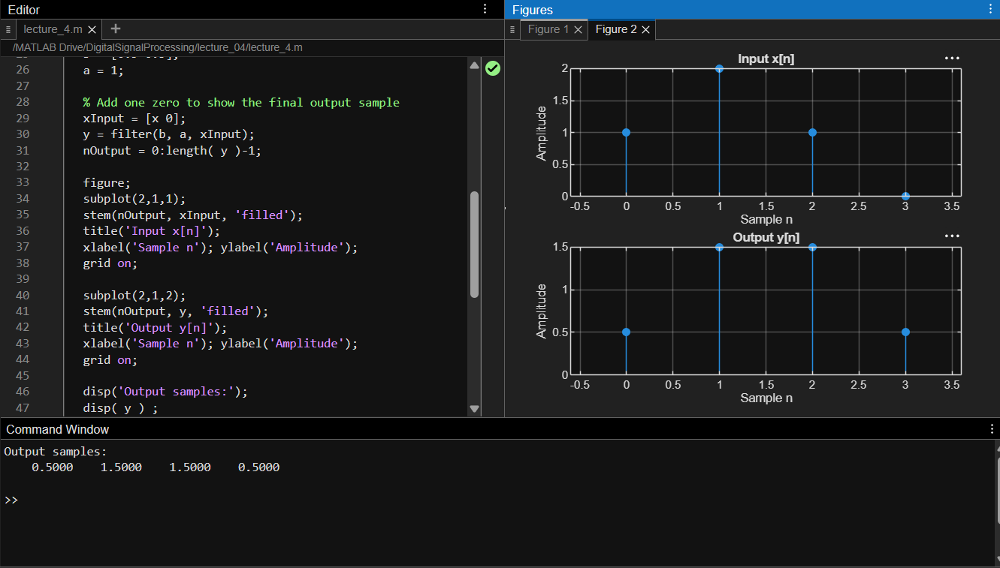
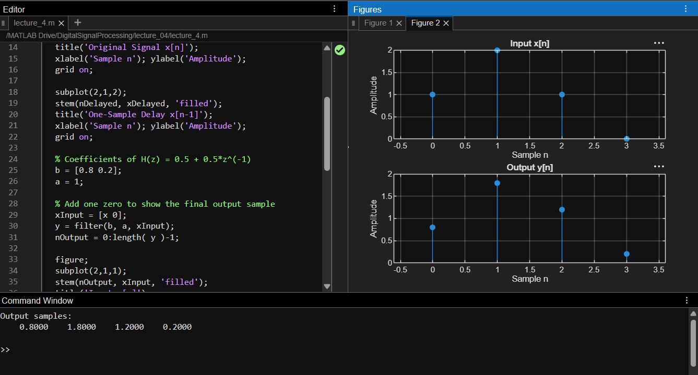
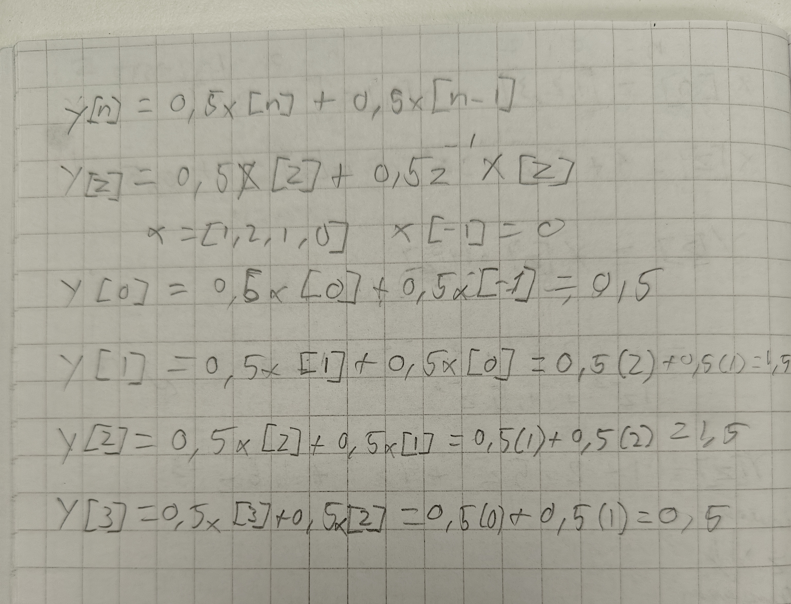

# DSP Assignment: Z-Transform Analysis

## Part 1: A Signal and Its Z-Transform

### Task 1: Sample Terms in X(z)
The constant 1 represents sample x[0] = 1. The term 2z^-1 represents sample x[1] = 2. The term z^-2 represents sample x[2] = 1.

### Task 2: Z-Transform of Delayed Signal
The Z-transform of the delayed signal is X_delayed(z) = z^-1 + 2z^-2 + z^-3, which equals z^-1 * X(z).

### Task 3: Delay Multiplication by z^-1
Delaying a signal by one sample shifts time index n to n - 1. In the Z-transform definition, this shift increases each negative exponent of z by one, which factors out as a multiplication by z^-1.

## Part 2: A System with One Sample Delay

### Task 4: Hand Calculation and MATLAB Comparison
Calculated values are y[0] = 0.5, y[1] = 1.5, y[2] = 1.5, and y[3] = 0.5. These hand-calculated results match the MATLAB output exactly.

### Task 5: Numerator Vector b Representation
Vector b holds numerator coefficients ordered by decreasing powers of z. The element b(1) = 0.5 represents the constant term for current input x[n], while b(2) = 0.5 represents the z^-1 term for delayed input x[n-1].

### Task 6: Modified System H(z) = 0.8 + 0.2z^-1
Setting b = [0.8 0.2] gives the current input sample x[n] greater influence on the output with an 80% weight, compared to a 20% weight for the previous sample x[n-1].

