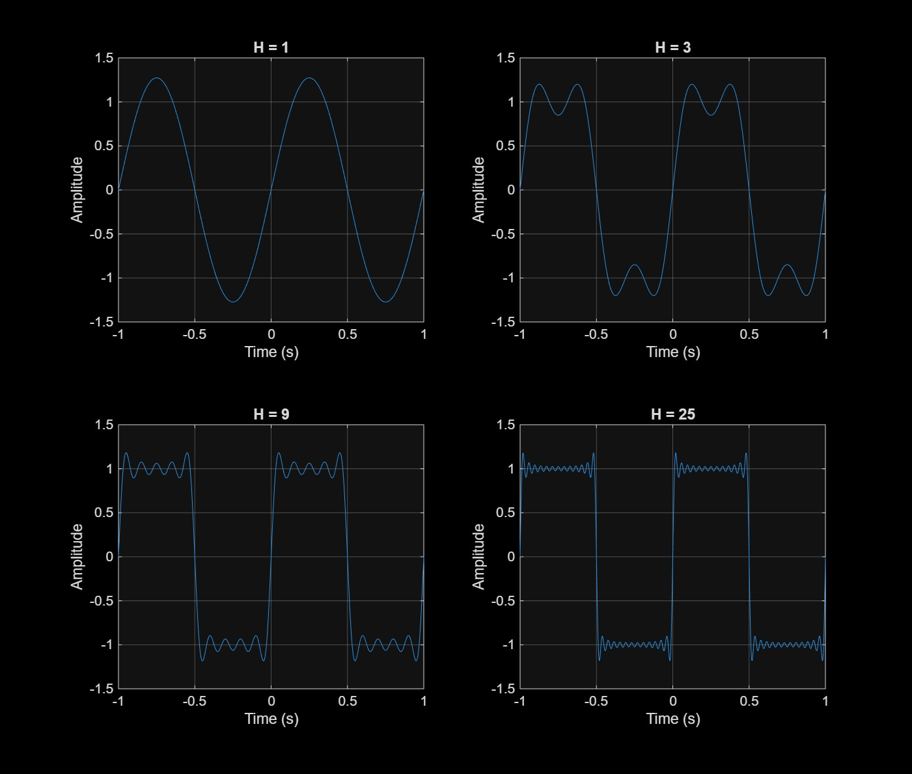
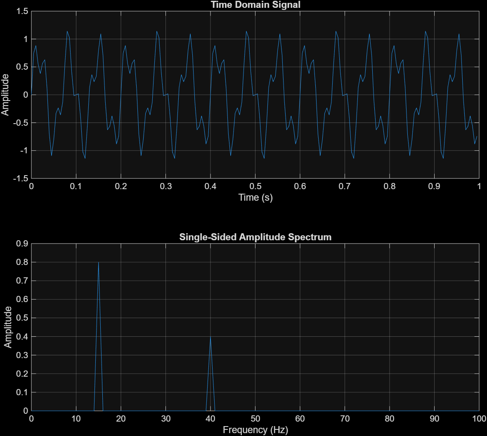
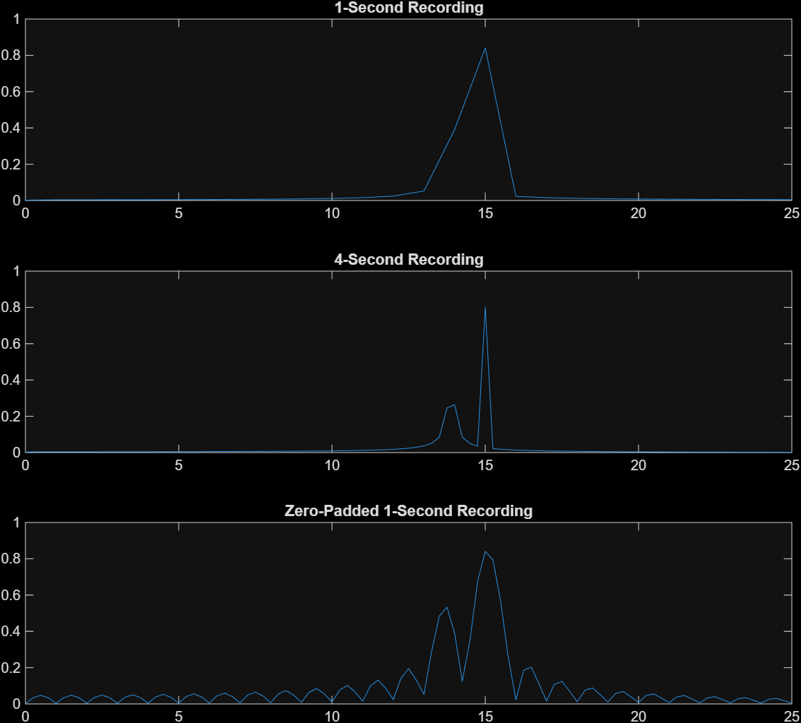
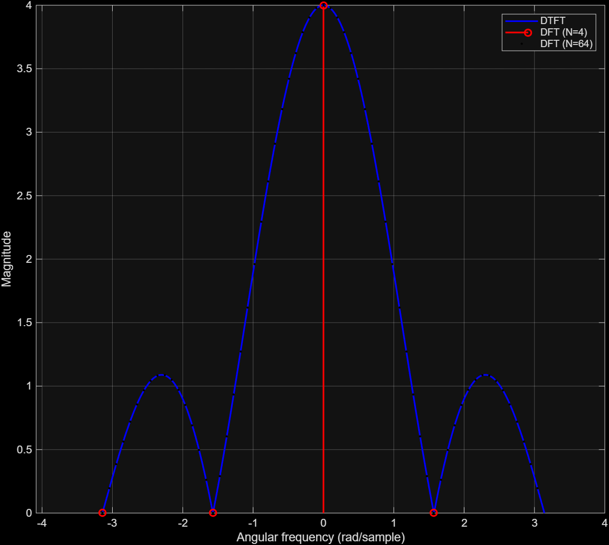

# Signal Processing Lab Exercises

## Exercise 1: Build a Square Wave from Harmonics

*   **Prediction:** I predict that as more of harmonics are added to the smooth sine-wave, it starts to look like a square wave.
*   **Description of Changes:** As $H$ increases, the rise and fall times become much shorter and the flatter portions at the top and bottom of the wave become smoother.
*   **Observation Near Transitions:** There are ripples or overshoots before and after the faster and sharper wave changes. This is known as the Gibbs phenomenon, and the amplitude of this overshoot does not disappear even as $H$ becomes very large.

## Exercise 2: Find Two Frequencies with the FFT

*   **Prediction:** The signal contains a 15 Hz component with an amplitude of 0.8, and a 40 Hz component with an amplitude of 0.4.
*   **Peak Identification:** The plotted single-sided amplitude spectrum shows two spikes 15 Hz at amplitude 0.8 and 40 Hz at amplitude 0.4. These measured values perfectly match the expected values used to create the signal.
*   **Bin Spacing Calculation:** The frequency-bin spacing is calculated using the formula $\Delta f = f_s / N$. With a sampling frequency of $f_s = 200$ Hz and $N = 200$ samples (for a 1-second recording), the bin spacing is $200 / 200 = 1$ Hz.

## Exercise 3: Investigate Spectral Leakage

*   **Digit and Calculated Frequency:** $d = 4$ (my student numbers last digit), which makes $f_2 = 13.2 + 0.17(4) = 14$ Hz.
*   **Prediction:** I predict the energy will leak across adjacent frequency bins (spectral leakage). The peak amplitude will appear lower than its true value of 0.4.
*   **Explanation of Spectral Differences:** 
    *   **4-second vs. 1-second recording:** The 4-second recording increases the frequency resolution by shrinking the bin spacing to $\Delta f = 200 / 800 = 0.25$ Hz. Because of this finer resolution, the peak at 14 Hz becomes sharper and more noticable. In 1-second recording the 15 Hz  peak has a tail where 14 Hz energy is lurking. 
    *   **Zero-padding:** Calculating `fft(x, 4*length(x))` by zero-padding the 1-second signal to 800 points visually smooths the spectrum and makes the leakage pattern (the sinc-function shape) much easier to see.

## Exercise 4: Compare the DTFT and DFT

*   **Comparison of Curves:** The DTFT produces a continuous, smooth curve representing all frequencies. The DFT calculated with `fft(x,4)` produces exactly 4 points. These 4 points perfectly sample the DTFT at its peak and at its zero crossings, this makes the signal look flat with only those 4 points plotted.
*   **Why fft(x,64) has more points:** Supplying 64 to the FFT function zero-pads the original 4-point sequence with additional 60. This calculates the frequency response at 64 distinct points between $0$ and $2\pi$, effectively following the continuous DTFT shape. It does not add new time-domain samples or new information to the original sequence.
*   **DTFT Zeros:** Looking at the continuous DTFT plot, the magnitude becomes zero at the angular frequencies $\omega = -\pi, -\pi/2, \pi/2$, and $\pi$.

