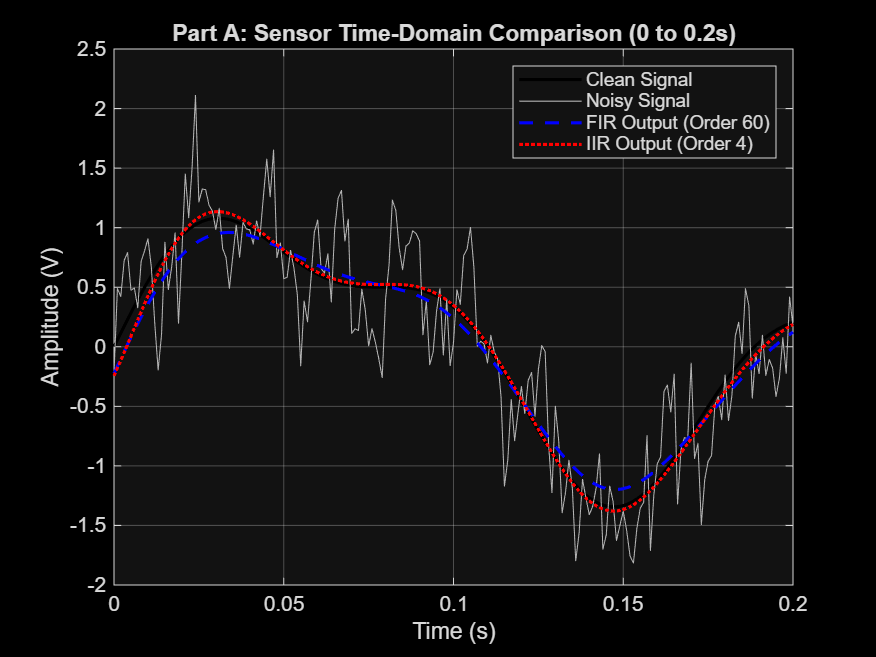
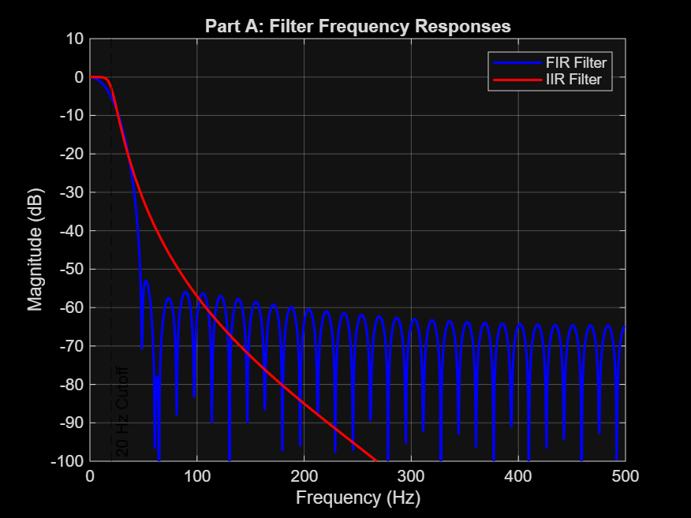
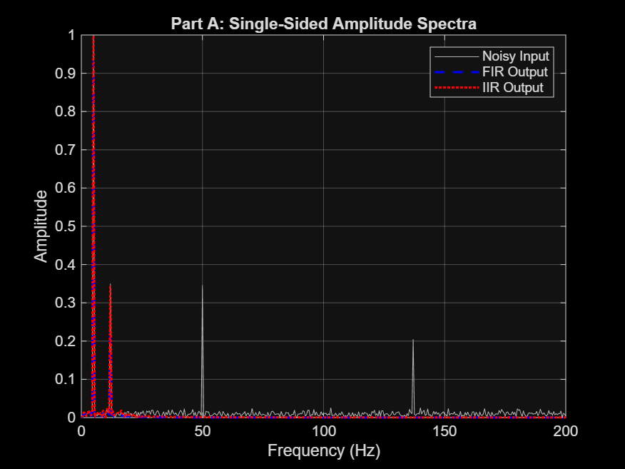
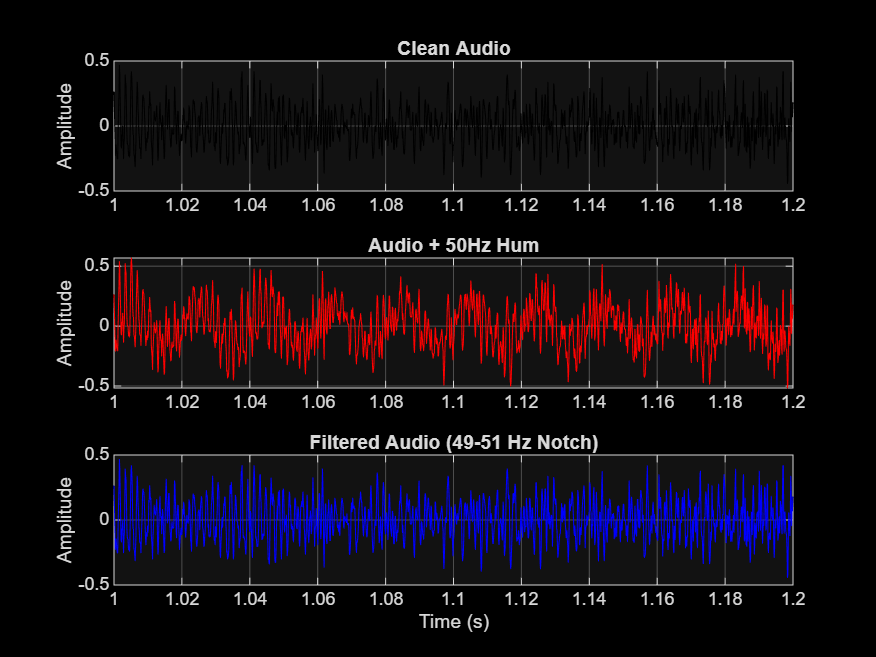
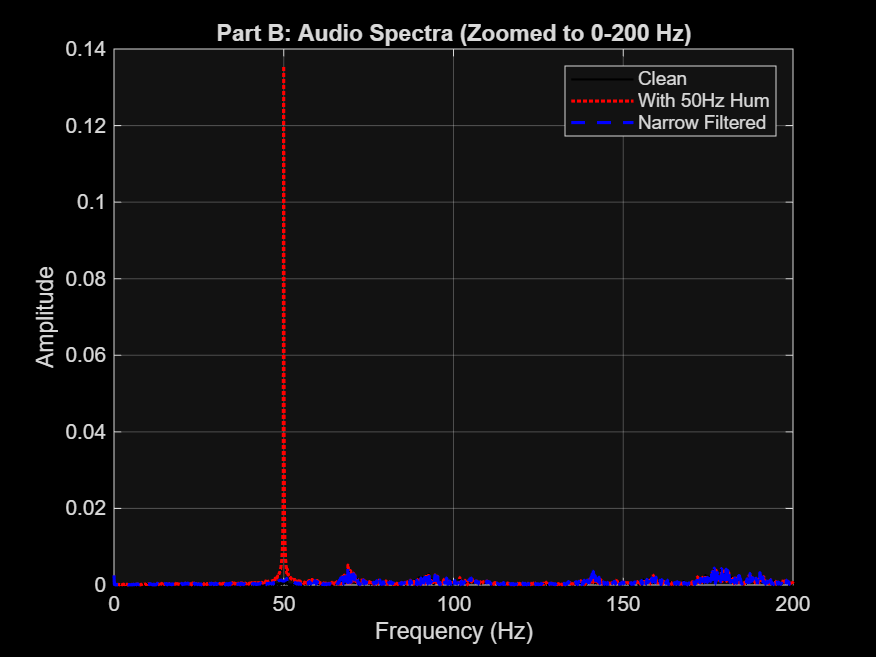
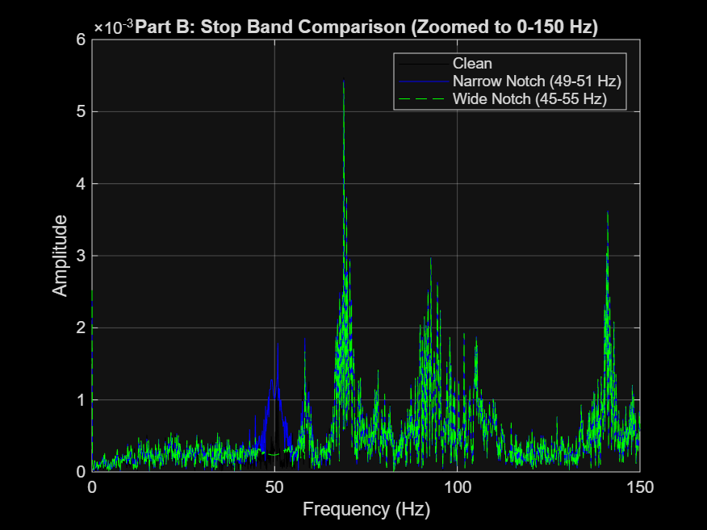

# Digital Signal Processing: Filter Design and Analysis

## Part A: Filter a Sensor Signal

### 1. Why is a 20 Hz low-pass reasonable for Part A, and what assumption does it make about the wanted sensor signal?
The clean sensor signal contains 5 Hz and 12 Hz components. The added noise includes 50 Hz and 137 Hz tones, as well as random noise. A 20 Hz cutoff keeps the two signal frequencies while reducing the higher-frequency noise.

This assumes that the useful parts of the sensor signal are below 20 Hz. If the sensor has useful information above that frequency, the filter could remove some of it too.

### 2. Which filter gives the better result for the requirements you chose? Support the answer with at least two kinds of evidence.
The 4th-order Butterworth IIR filter had a lower RMSE than the 60th-order FIR filter when I compared both outputs with the clean signal. The frequency-response plot also shows that the IIR filter rolls off quickly above 20 Hz, using fewer coefficients than the FIR filter.

I used `filtfilt` for both filters, so the results do not have the phase shift that a one-pass filter would introduce.

### 3. How would your implementation change if the sensor had to be filtered live with low latency?
The code uses `filtfilt`, which needs the full signal and cannot be used as samples arrive. For real-time filtering, I would use a causal, single-pass filter such as `filter(b, a, x)`.

- The IIR filter would add a frequency-dependent delay.
- The 60th-order FIR filter would add a delay of 30 samples, or 30 ms at a 1,000 Hz sampling rate.
- The code would need to process samples as they arrive, or in small blocks, instead of loading the whole signal first.

### 4. Why is a narrow band-stop appropriate for a steady 50 Hz hum? What would you do if the interference frequency drifted?
I used a narrow 49–51 Hz band-stop filter to reduce the 50 Hz hum without removing as much of the surrounding audio. If the hum frequency changes, an adaptive filter could track it. Another option is to use a wider stopband, but that would also affect more of the audio.

### 5. Describe one limitation of your experiments and one improvement you would make in a real measurement system.
The noise in this experiment is simulated with steady tones and random noise. Real sensor noise can change over time, clip the signal, or be affected by the environment.

For a real system, I would also use an analog anti-aliasing filter before the signal is sampled. Shielding the sensor wiring could help reduce electrical interference.

## Figures

The figures below show the sensor signal, filter responses, audio waveforms, and the effect of the narrow and wide stopband filters.

